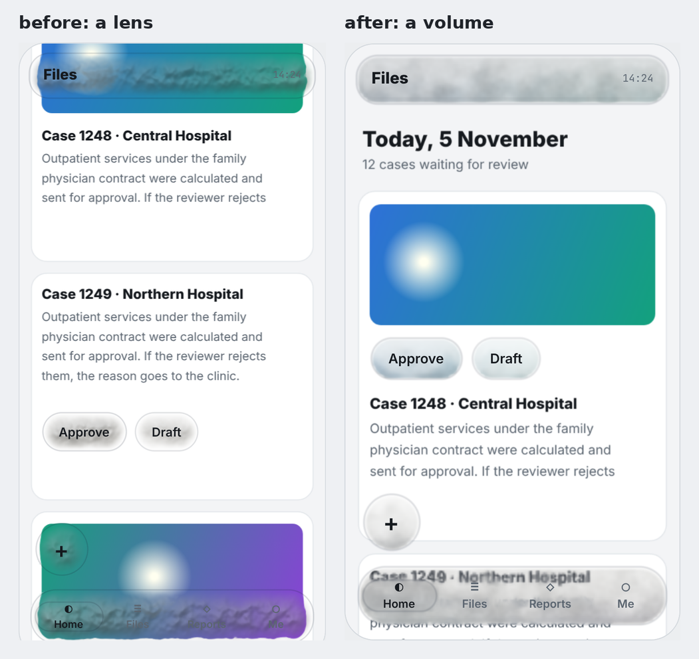
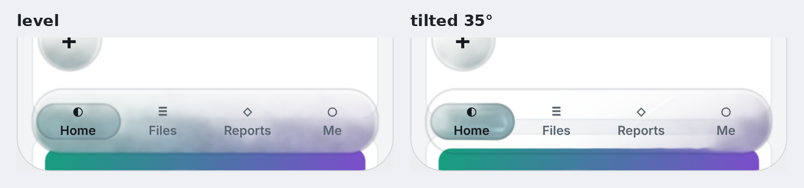
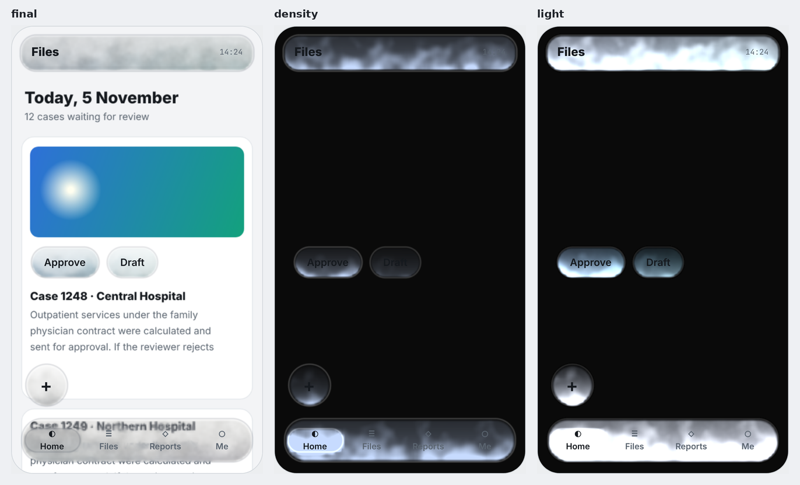
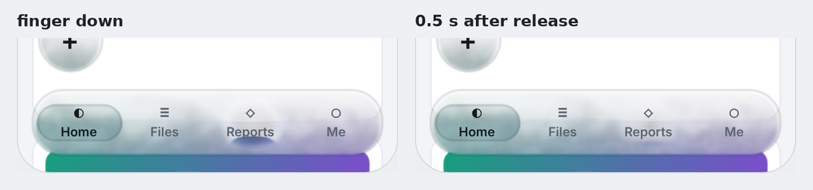
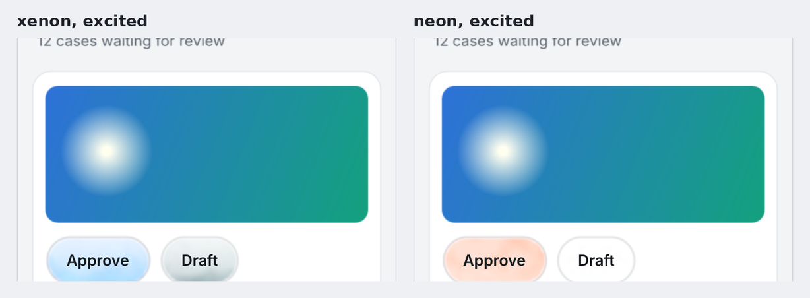
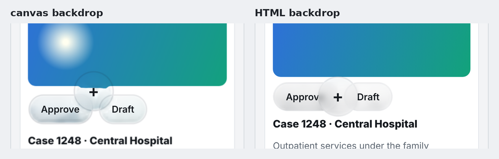

# My gas interface looked like glass. Four things fixed it.

*Notes from building AID, an interface material made of noble gas.*

A few weeks ago I asked a simple question: what if a button was not a slab of glass, but a sealed chamber of gas?

I built it. It had a compressible gas simulation, refraction derived from real refractive indices, and light scattering. I was proud of the physics.

Then I looked at the result honestly, and it looked like Liquid Glass.

*Left: the first version. Right: the current one. Same content, same gas (xenon), same components.*

## Why it read as glass

A translucent shape that blurs and bends whatever is behind it reads as glass. It does not matter what the code calls it.

My gas got denser from the wall of the container toward the middle. That density slope bent the background most strongly at the rim, which is exactly what a lens does. And my "light from the content" was, in practice, a blur of whatever sat directly underneath.

So I stopped asking how to render gas, and asked a different question: **what does a gas do that a piece of glass cannot?**

I found four answers. Each one became a behaviour of the material, and where it needed one, a parameter.

## 1. A gas has weight

Xenon is about 4.5 times denser than air. Heavy gases pool. There is a classic demonstration where a foil boat floats in an apparently empty tank, on an invisible layer of sulfur hexafluoride.

So the gas in an AID container is no longer spread evenly. Xenon settles into a layer at the bottom with a soft, billowing top, like fog in a valley. Helium is lighter than air, so it collects under the top wall. How strongly each gas settles follows its real molar mass relative to air.

And because the layer follows gravity, it can follow the device. Tilt the phone and the gas slides to the low side.

*`--aid-weight` sets how strongly the gas settles. `--aid-tilt`, or the device itself, sets the direction of gravity.*

A piece of glass has nothing inside it that could move.

## 2. A gas is lit by its surroundings

A noble gas is colourless and has no light of its own. What you see of a fog is the light it catches.

In AID every colour on the screen is a light source. The gas gathers light from a radius around each container and takes on that colour. The important part is "around": an image that is *next to* a button tints the side of the gas that faces it. A backdrop blur can only show what is directly behind the element.

*Final, the density of the gas alone, and the light the gas picks up. The buttons sit under the image, not on it, and still take its blue.*

## 3. A gas refracts only where it is disturbed

This was the change that removed the glass look.

At rest, the gas now veils what is behind it but does not bend it. Text under a bar gets softer and dimmer with depth, and nothing is distorted at the wall.

Refraction is reserved for disturbance. When a finger pushes the gas, or thermal motion stirs it, the density changes, and only that change bends light. I render it two ways: as a small displacement of the background, and as a shadowgraph. A shadowgraph is the technique used to photograph shock waves and the heat rising from a candle; its brightness follows the second derivative of the refractive index.

*The gas is pushed aside and settles back. It is heavily damped, so it never rings or wobbles: waves read as liquid.*

## 4. A noble gas can be excited

Noble gases are famous for one thing: run a current through them and they glow, each in its own colour. Neon is red, argon violet, xenon blue.

AID has a parameter for that, `--aid-excitation`. I use it as a state. A button that has keyboard focus glows in the colour of its gas.

*Same button, same parameter, different gas.*

## Parameters that belong to the material

I did not want to rename blur radius and call it new. These are the material's own controls, set in CSS like any other token:

| Token | What it is |
|---|---|
| `--aid-gas` | helium, neon, argon, krypton or xenon |
| `--aid-pressure` | how much gas a container holds |
| `--aid-agitation` | thermal motion and shimmer |
| `--aid-refraction` | how strongly a disturbance bends light |
| `--aid-weight`, `--aid-tilt` | how strongly the gas settles, and which way is down |
| `--aid-light-reach`, `--aid-glow` | how far content light travels, and how much colour the gas keeps |
| `--aid-excitation` | glow discharge |

## Two details that mattered

**Depth.** When a floating button passed over another button, nothing happened. They looked like two stickers on one sheet. Now a container that sits above another fogs the one below: its wall, its gas and its label.

**The wall.** A container still needs a visible boundary, because the top of a settled container holds almost no gas. But a hard hairline looked like a glass edge. The wall is now a soft line, about two pixels wide and faint.

## What is physics and what is not

Every behaviour in the specification carries one of three labels: *physical*, *approximation* or *artistic*.

The direction and the ratios of settling are physical. The thickness of the layer is artistic: a real heavy gas does pool in air, but in a much deeper layer, and it mixes over time. The discharge colours are the published ones. Using a discharge as a focus state is my decision, not nature's.

I think a material that borrows from nature should say exactly where it stops borrowing.

## What I do not know yet

- I have not measured frame rate, heat or battery on real phones.
- Helium and neon scatter so little light that they are close to invisible. That is accurate, and not very useful.
- On a wide bar the settled layer reads clearly as gas. On a small button it may read as a plain gradient. That needs a test with real people.
- I searched for earlier work and found smoke and fluid button effects, but not a design system built on these behaviours. My search was not exhaustive.
- On ordinary HTML pages, the browser does not let WebGL read the page. Settling and excitation work there; content light and refraction need the content on a canvas.

## Try it

The code is MIT licensed and runs in the browser: WebGL2 and five Web Components.

- Lab: [miladkm77.github.io/aid/lab.html](https://miladkm77.github.io/aid/lab.html)
- Source and specification: [github.com/miladkm77/aid](https://github.com/miladkm77/aid)

Switch the gas from xenon to helium, drag the tilt slider, and press a bar. If it still reads as glass to you, tell me where.

---

Sources: discharge colours from LibreTexts, [Gas Discharge Tubes](https://chem.libretexts.org/Ancillary_Materials/Demos_Techniques_and_Experiments/Lecture_Demonstrations/Additional_Demos/Gas_Discharge_Tubes). Shadowgraph from Wikipedia, [Shadowgraph](https://en.wikipedia.org/wiki/Shadowgraph). The floating boat: Gizmodo, [Watch a model boat float on a sea of gas](https://gizmodo.com/watch-a-model-boat-float-on-a-sea-of-gas-5875071).
