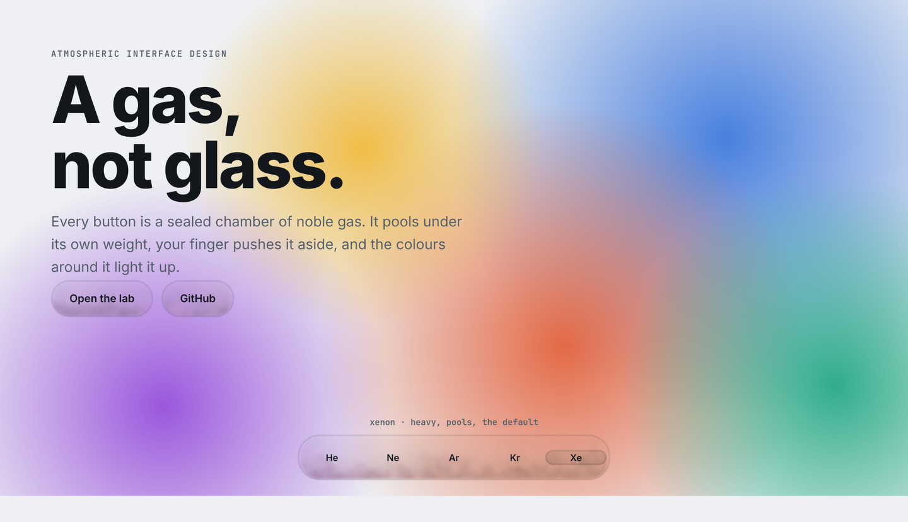
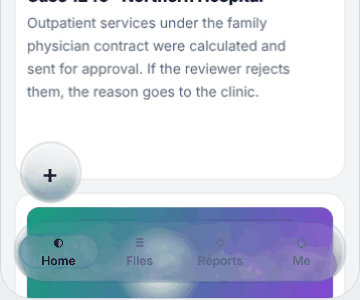

# AID · Atmospheric Interface Design

**An interface language made of gas.** Every control is a sealed container of noble gas, and interface state is the state of that gas: a pressed button is compressed gas, a disabled one is a vacuum, a focused one glows in the colour of its element.



**[Read the article](ARTICLE.md)** · **[Live lab](https://miladkm77.github.io/aid/lab.html)** · **[Specification](SPEC.md)**



## What a gas does that glass cannot

- **It has weight.** Xenon is 4.5 times denser than air, so it settles into a layer at the bottom of its container. Helium rises. Tilt the device and the layer slides.
- **It is lit by its surroundings.** An image next to a button tints the gas that faces it.
- **It bends light only where it is disturbed.** At rest the gas veils the background without distorting it. A finger or thermal motion shows as shimmer and as light and dark streaks.
- **It can be excited.** A focused control glows in the discharge colour of its gas: xenon blue, neon red, argon violet.
- **It has depth.** A container that floats above another fogs the one below.

## The grammar

| Interface meaning | Physical quantity | Token or state |
|---|---|---|
| Emphasis | Pressure | `--aid-pressure` |
| Pressed | Compression | pointer down |
| Disabled | Vacuum | `disabled` |
| Selected | A filled chamber | `<aid-tab selected>` |
| Focus | Excitation | `--aid-excitation`, keyboard focus |
| Elevation | Fogging | `z-index` |
| Context | Illumination | `--aid-light-reach`, `--aid-glow` |
| Orientation | Weight | `--aid-weight`, `--aid-tilt`, `tilt="device"` |
| Activity | Agitation | `--aid-agitation` |

Every behaviour is labelled *physical*, *approximation* or *artistic* in [SPEC.md](SPEC.md).

## Quick start

```html
<script type="module" src="dist/aid.js"></script>

<aid-scene style="--aid-gas: xenon; --aid-temperature: .45">
  <aid-gas class="bar">Files</aid-gas>
  <aid-button>Approve</aid-button>
  <aid-button disabled>Send</aid-button>
  <aid-tabs>
    <aid-tab selected>Home</aid-tab>
    <aid-tab>Reports</aid-tab>
  </aid-tabs>
</aid-scene>
```

## Parameters

The parameters belong to AID and are plain CSS custom properties:

```css
aid-scene { --aid-gas: xenon;        /* helium | neon | argon | krypton | xenon */
            --aid-agitation: .45;    /* thermal motion and shimmer, 0-1 */
            --aid-refraction: 140;   /* gain of displacement, shimmer and shadowgraph */
            --aid-weight: .6;        /* how strongly the gas settles, 0-1 */
            --aid-tilt: 0;           /* direction of gravity in degrees */
            --aid-light-reach: 140;  /* px: how far content light travels into the gas */
            --aid-glow: 1;           /* how much of the gathered colour the gas keeps */
            --aid-smoke: .5;         /* smoke texture and absorption */
            --aid-spectral: .1;      /* colour of scattering; 0 is neutral grey */
            --aid-quality: auto; }   /* auto | static | efficient | high */
.bar      { --aid-pressure: 1.2;     /* density held by one container */
            --aid-weight: .25; }     /* a bar over scrolling text settles less */
.primary  { --aid-excitation: .8; }  /* glow discharge in the colour of the gas */
```

The full list, the physical model and the label of every behaviour are in [SPEC.md](SPEC.md).

## Design system

**[Every component in every state](https://miladkm77.github.io/aid/system.html)** · light and dark · left-to-right and right-to-left.

| Component | What it is | States |
|---|---|---|
| `<aid-button>` | `variant` default, primary, danger, quiet · `size` sm, md, lg · `icon` · `loading` | rest, hover, pressed, focus, loading, disabled |
| `<aid-chip>` | a toggle for filters and tags | unselected, selected, hover, focus, disabled, static |
| `<aid-field>` | the chamber around a native `input`, `textarea` or `select` | rest, hover, focus, invalid, disabled |
| `<aid-checkbox>` `<aid-radio>` `<aid-switch>` | selection controls; work inside a `<label>` | off, on, mixed (checkbox), hover, focus, disabled |
| `<aid-tabs>` `<aid-tab>` | a tab bar; the selected chamber is filled | selected, unselected, disabled |
| `<aid-progress>` | a tube that fills; indeterminate without `value` | value, indeterminate |
| `<aid-card>` | a quiet surface for grouped content | rest, `interactive` |
| `<aid-dialog>` | a modal: it fogs the whole scene below it | open, closed, `persistent` |
| `<aid-alert>` | an inline message; `kind` info, success, warning, danger | |
| `<aid-toast>` · `toast()` | a transient message; closes itself, holds while hovered or focused | |
| `<aid-menu>` `<aid-menu-item>` | a popover list of actions, opened by the element named in `for` | open, closed; item rest, hover, focus, danger, disabled |
| `<aid-slider>` | a range: `min`, `max`, `step`, `value` | rest, hover, focus, dragging, disabled |
| `<aid-tabs vertical>` | the same tab bar as a side navigation | |
| `.aid-table` | a plain data table on the tokens; data is content, so it carries no gas | row hover, `aria-selected` |
| `<aid-icon>` | 36 line icons on a 24 px grid; directional ones mirror in right-to-left | |
| `<aid-gas>` | the bare container, for anything else | |

Foundation tokens (colour, type, space, radius, control sizes) are injected with zero specificity, so any rule of yours overrides them. Theme follows `prefers-color-scheme`; `data-aid-theme="light"` or `"dark"` forces one.

Keyboard: buttons and chips respond to Enter and Space, checkboxes and switches to Space, radios and tabs to the arrow keys (right-to-left aware), dialogs trap Tab and close on Escape, menus move with the arrow keys, Home and End and close on Escape, sliders step with the arrow keys and jump with Home and End. `prefers-reduced-motion` selects the static tier.

## Use it in an app or a PWA

Step-by-step guide for adding AID to an existing product: [INTEGRATION.md](INTEGRATION.md).

AID is plain web technology (WebGL2 and Web Components), so it runs wherever a web app runs, including an installed PWA. Use one fixed scene for the whole app:

```html
<aid-scene fixed>
  <!-- your whole app -->
</aid-scene>
```

A fixed scene draws on one viewport-sized canvas: one GPU context however long the page is, and only the containers in view are simulated (up to 96 at once). Containers inside scrolling areas are clipped to them. Cache `aid.js` in your service worker like any other script; the documentation site itself is installable and is the reference for that.

## Two backdrop modes

- `backdrop="dom"` (default): the content behind is ordinary HTML. WebGL cannot read the page, so only the gas is drawn, with a CSS backdrop blur standing in for scattering. Settling and excitation work; refraction of the page and content light do not.
- `backdrop="canvas"`: the content behind is a canvas or image passed with `scene.setBackdrop(canvas)`. The full model runs: refraction and content light.

## Performance

| Tier | Simulation | Light taps |
|---|---|---|
| static | none, analytic | 5 |
| efficient | 80-cell grid, 30 Hz | 9 |
| high | 128-cell grid, 60 Hz | 13 |

The engine runs only when something changes and sleeps when idle. Sustained frame rate, heat and battery have not yet been measured on real phones.

## Development

```
npm install
npm run build      # dist/aid.js (ESM), dist/aid.min.js (IIFE, global AID), types
npm run typecheck
npx http-server .  # or python3 -m http.server, then open /demo/
npm run pages      # rebuilds the static site in docs/
```

## Status

Version 0.3. Open items: verifying the refractivity of Ne, Ar, Kr and Xe against a dispersion table, a user study, device measurements, native ports, and more components (table, menu, toast, slider, date picker).

## License

MIT © Milad Karami Motlaq
